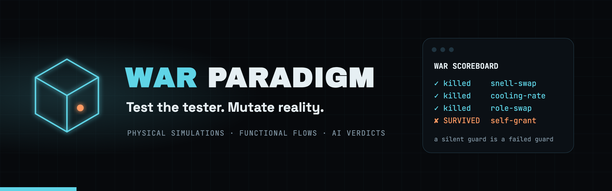
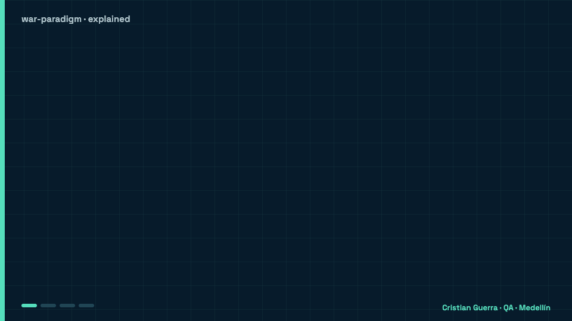

<p align="center">
  
</p>

<p align="center">
  <a href="https://github.com/criguex/war-paradigm/actions/workflows/ci.yml"></a>
  
  
  <a href="LICENSE"></a>
</p>

# WAR Paradigm

**No probamos el software. Probamos al que prueba.** · [Read in English](README.md)

## Explicado para un niño de 8 años

Las pruebas son como guardias cuyo trabajo es gritar cuando algo está mal. Pero un guardia que nunca grita puede ser excelente, o puede estar dormido. Para saberlo, rompemos algo a propósito (una regla de la física en una simulación, o un paso de una aplicación) y miramos al guardia. Si grita, la trampa quedó atrapada: **KILLED**. Si se queda callado, el guardia tiene un punto ciego: **SURVIVED**, y ese es el hallazgo.

<p align="center">
  
</p>

### Un ejemplo real (experimento 02)

- **Imagina** una aplicación pequeña donde la gente inicia sesión, crea una publicación, alguien la aprueba y se publica. Todas las pruebas están en verde.
- **Rompemos un paso a propósito:** un usuario que solo puede mirar intenta aprobar. La app responde 403, "no tienes permiso". La trampa quedó atrapada: KILLED.
- **Otra trampa:** un editor se cambia su propio rol a admin. La app dice que sí (HTTP 200), así que ese editor podría aprobar y publicar solo. Todas las pruebas del camino feliz estaban en verde mientras esto seguía abierto.
- **Una trampa que agregamos al preparar el curso:** un usuario de solo lectura crea un borrador. La tabla de roles dice 403; la app dice que sí (HTTP 201). El WAR Paradigm encontró un hueco en su propia app de ejemplo.
- **Qué ganamos:** 5 de 7 trampas quedaron atrapadas, y las dos que se escaparon son bugs reales de autorización en la app de demostración. Siguen impresas en rojo hasta que alguien los arregle.

### Palabras difíciles

| Palabra | Qué significa |
|---|---|
| **Suite de pruebas** | Todas las revisiones de un programa, juntas. |
| **Mutante** | Una copia del mundo con exactamente una cosa rota a propósito. |
| **Oráculo** | La hoja de respuestas que dice cuál es el resultado correcto. |
| **KILLED** | Las pruebas atraparon lo que se rompió. Buena noticia. |
| **SURVIVED** | Las pruebas no lo vieron: un bug real o un punto ciego. |
| **Flujo dorado** | El camino normal que siempre debe funcionar: login → crear → aprobar → publicar. |
| **403** | La forma en que la app dice "no tienes permiso". |

## La idea

Toda suite de pruebas, oráculo, verificador de pruebas formales o juez de IA es un guardia que debería gritar cuando algo está mal. Un guardia que nunca grita puede ser excelente, o puede estar dormido. WAR Paradigm es la forma de saberlo: construir un mundo donde sabes exactamente qué está mal, porque lo rompiste a propósito, y ver si el guardia lo nota.

- Rompe una ley física dentro de una simulación. ¿El oráculo lo nota?
- Rompe un paso de un flujo de negocio. ¿La suite lo nota?
- Disfraza un comando prohibido. ¿La barrera lo nota?

Si el guardia se queda callado, el guardia falló. Ese es el hallazgo.

> Antes se llamaba **The Mutant Lab**: son los mismos experimentos, y ahora el nombre dice qué los une. *WAR* viene de Guerra, el apellido del autor: una guerra contra los bugs, empezando por los que se esconden dentro de las propias pruebas. Los enlaces viejos a `criguex/mutant-lab` redirigen aquí.

```bash
git clone https://github.com/criguex/war-paradigm.git && cd war-paradigm
npm ci && npx playwright install --with-deps chromium
npm test
```

## El paradigma en cuatro pasos

| Paso | Qué pasa | Simulación física | Flujo funcional |
|---|---|---|---|
| **1 · Generar** | Construir la realidad base y confirmar que el guardia la acepta | Refracción de Snell con los índices reales | El flujo dorado: login → crear → aprobar → publicar |
| **2 · Mutar** | Cambiar exactamente una regla, a propósito | Intercambiar los dos índices de refracción | Un usuario de solo lectura intenta aprobar |
| **3 · Auditar** | Pasar el mundo roto frente al guardia | Un oráculo independiente con tolerancia congelada de 10⁻⁶ | Verificaciones de Playwright contra la API |
| **4 · Validar** | Leer el veredicto | **KILLED**: el oráculo lo rechaza | **KILLED**: la app responde 403 |

Tres veredictos, siempre reportados y nunca escondidos:

- **PASS**: la línea base sin mutar se comporta como dice la especificación, así que el guardia no está dando falsas alarmas.
- **KILLED**: el guardia atrapó la mutación. La prueba tiene dientes.
- **SURVIVED**: el guardia no la vio. Es un bug real o un punto ciego en las pruebas. Queda visible, impreso en rojo y en seguimiento, hasta que alguien lo arregle.

## Dos pistas, un paradigma

### Pista 1 · Simulaciones físicas → [criguex/scientific-qa-evidence](https://github.com/criguex/scientific-qa-evidence)

Nueve modelos numéricos sintéticos: circuito RC, enfriamiento de Newton, cinética química de segundo orden, atenuación de Beer–Lambert, respuesta logística, refracción de Snell, lente delgada, interfaz acústica y respuesta de Fechner. Cada uno tiene un oráculo independiente que no comparte código con la implementación, y un contrato cuya tolerancia se congeló antes de cualquier corrida. Después se rompe la física a propósito: una constante de tiempo duplicada, una tasa de enfriamiento a la mitad, índices de refracción intercambiados.

- **84 variantes pareadas**, corridas en macOS arm64 y en Linux x86_64 con clasificaciones idénticas.
- **27 PASS** · **54 KILLED** (51 comportamientos distintos; dos mutantes acústicos dan la misma salida) · **3 SURVIVED**: la mutación RC deliberadamente diminuta, que se dejó visible a propósito.

El mismo repositorio aplica la idea a pruebas formales: dos verificadores independientes, el kernel de Lean y nanoda, deben rechazar una prueba deliberadamente incorrecta, y ambos la rechazan. Esa pista es una reproducción de QA de las pruebas en Lean que publicó OpenAI para Navier–Stokes y Euler. No demuestra nada nuevo ni reclama ningún resultado del Premio del Milenio; sus limitaciones están en su README.

### Pista 2 · Funcionalidades → este repositorio

| # | Experimento | El guardia bajo prueba | La pregunta que responde | Estado | Correrlo |
|---|---|---|---|---|---|
| 01 | [**Veredicto de IA**](experiments/01-ai-verdict) | El juez: oráculos y un puntaje para la salida de IA | La salida de la IA cambia en cada corrida. ¿Puede el veredicto mantenerse igual? | ✅ ejecutable | `npm run demo:01` |
| 02 | [**Escenarios mutantes**](experiments/02-mutants) | La suite: un flujo dorado de Playwright en verde | Tu suite está en verde. ¿Notaría si la app se rompe? | ✅ ejecutable · 1 hallazgo conocido | `npm run demo:02` |
| 03 | [**Segundo cerebro**](experiments/03-second-brain) | La barrera: un hook de Claude Code | La IA sin contexto escribe pruebas genéricas. ¿Qué lo arregla? | ✅ ejecutable | `npm run demo:03` |
| 04 | próximo espécimen | | | 🧪 planeado | |

#### 01 · Veredicto de IA

Dos preguntas, dos oráculos. *¿Funciona como se especificó?* es determinista: esquema, roles y códigos de estado, verificados en código. *¿Lo que produjo es bueno?* es un puntaje contra criterios de aceptación explícitos: los criterios `must` bloquean, los `should` suman a un puntaje ponderado, y cada criterio lleva evidencia calculada por código. Luego la misma entrada corre tres veces; si el veredicto cambia, el que falló es el juez. Incluye corridas grabadas (un set fijado y estable, otro sin fijar que cambia) y un adaptador para conectar un agente real con una variable de entorno.

#### 02 · Escenarios mutantes

Una app web pequeña con un flujo dorado (login → crear → aprobar → publicar) y una suite de Playwright. Los mutantes son datos: un cambio en el flujo cada uno, y la corrida clasifica la respuesta HTTP como evidencia. Las fallas del flujo base y del reinicio quedan fuera del puntaje de mutantes, un hallazgo conocido solo se anota después de observar que la mutación fue aceptada, y cada escenario adjunta un registro JSON con la revisión del código y los hashes de las entradas. Cinco mutantes mueren. Dos sobreviven y revelan bugs reales de autorización en la app de demostración: con self-grant un usuario puede darse a sí mismo un rol más alto, y con viewer-create (encontrado al preparar el curso) un usuario de solo lectura puede crear borradores. Un ejemplo más grande y real del mismo motor: [criguex/civica-playwright-challenge](https://github.com/criguex/civica-playwright-challenge).

#### 03 · Segundo cerebro

Una plantilla de vault de Obsidian para QA asistido por IA: un mapa `READ FIRST`, reglas de oro, cinco carpetas predecibles y notas que responden una pregunta cada una y enlazan al resto. Y la parte que un prompt no puede hacer: un hook `PreToolUse` de Claude Code que bloquea cualquier `git push` a `main` con exit 2. La barrera se prueba al estilo WAR: 40 casos, incluidos comandos encadenados, opciones globales de git como `-c` y `--no-pager` y el `git push` a secas sobre `main`, intentan colarse. Seis límites conocidos todavía pasan con exit 0 (rama o subcomando en una variable, un alias de git, `sh -c`, `bash -c`, `eval`) y quedan fijados con pruebas: un hook con regex es una barrera contra errores, no un sandbox. Un verificador de enlaces mantiene el vault consistente.

## Por qué

La IA ya escribe documentos, planes, pruebas y código más rápido de lo que alguien alcanza a leer, y cada vez más también escribe las pruebas. Cuando el código y sus pruebas salen del mismo lugar, una corrida en verde demuestra menos de lo que parece. El cuello de botella pasó de *producir* a *decidir*: ¿esto está listo para salir? Una decisión que depende de cómo se siente el resultado no es una decisión, es un estado de ánimo. WAR Paradigm convierte ese estado de ánimo en evidencia sobre las pruebas mismas: aserciones donde la respuesta es binaria, puntajes contra criterios acordados donde no lo es, y mutantes, físicos o funcionales, para demostrar que las pruebas tienen dientes.

## Cómo funciona el laboratorio

- **Real, ejecutable y sin conexión.** Cada experimento corre con `npm test`, sin llaves ni red. Donde podría conectarse un modelo real, es opcional y explícito.
- **Grabado, no fingido.** Los fixtures son artefactos grabados y deterministas para que el veredicto se pueda reproducir; el código que los califica es el experimento.
- **Los hallazgos nunca se esconden.** Un mutante sobreviviente conocido se marca como fallo esperado y se imprime en rojo; no se borra ni se salta.
- **Pequeño a propósito.** Cada experimento es una carpeta que se lee de una sentada y se puede copiar a tu propio proyecto.

```
war-paradigm/
├── experiments/
│   ├── 01-ai-verdict/      runner de Playwright, TypeScript, corridas grabadas, puntaje, chequeo de estabilidad
│   ├── 02-mutants/         app web en node + flujo dorado en Playwright + mutantes como datos + reporter de marcador
│   └── 03-second-brain/    plantilla de vault de Obsidian + hook de Claude Code + suite de node:test
├── assets/                 marca
├── docs/                   animación explicada (docs/assets) y su fuente (docs/scenes)
└── .github/workflows/      un job corre todos los experimentos
```

Los comandos de cada experimento están en el README de su carpeta. Atajos en la raíz: `npm run test:01`, `test:02`, `test:03`, `demo:01`, `demo:02`, `demo:03`, `typecheck`.

## Servicios comerciales

El código es abierto. Lo que vendo es la experiencia de aplicarlo en sistemas reales y complejos:

- **Consultoría especializada.** Una auditoría WAR Paradigm de tus suites de pruebas, oráculos, simulaciones o evaluadores de IA, con un informe de lo que tus pruebas no están viendo y cómo cerrar cada brecha.
- **Soporte técnico.** Acompañamiento a empresas que adoptan el marco: puesta en marcha en tu CI, tus flujos y la forma de trabajar de tu equipo.
- **Integraciones y mejoras a la medida.** Adaptadores para tu stack, catálogos de mutantes para tu dominio, oráculos para tus simulaciones y funcionalidades hechas para lo que necesitas.

Escríbeme en [linkedin.com/in/criguex](https://www.linkedin.com/in/criguex) o a criguex@gmail.com.

## Licencia

WAR Paradigm es software libre publicado bajo la [Licencia Pública General de GNU v3.0 o posterior](LICENSE) (`GPL-3.0-or-later`). Copyright © 2026 Cristian Guerra.

Qué exige la GPL, en palabras simples. El texto de [LICENSE](LICENSE) es el que manda; este resumen no es asesoría legal.

- **Puedes** usar, estudiar, modificar y compartir el código, gratis o con fines comerciales.
- **Si lo distribuyes**, tal cual o modificado, o entregas un producto que incluya su código, debes:
  - ofrecer el código fuente completo de esa versión bajo la misma licencia;
  - conservar los avisos de copyright, el texto de la licencia y la línea `SPDX-License-Identifier` al inicio de cada archivo;
  - indicar qué cambiaste y cuándo;
  - no agregar restricciones adicionales para quienes lo reciban.
- **Ejecutarlo no es distribuirlo.** Usarlo internamente o en tu pipeline de CI no te obliga a publicar nada, y la aplicación que pruebas con él no se vuelve GPL.

Las versiones publicadas antes del 21 de octubre de 2026 salieron con licencia MIT, y esa licencia sigue aplicando a esas copias.

## Autor

**Cristian Guerra** · Senior SDET / AI-QA · Medellín, Colombia
[linkedin.com/in/criguex](https://www.linkedin.com/in/criguex) · [github.com/criguex](https://github.com/criguex)
